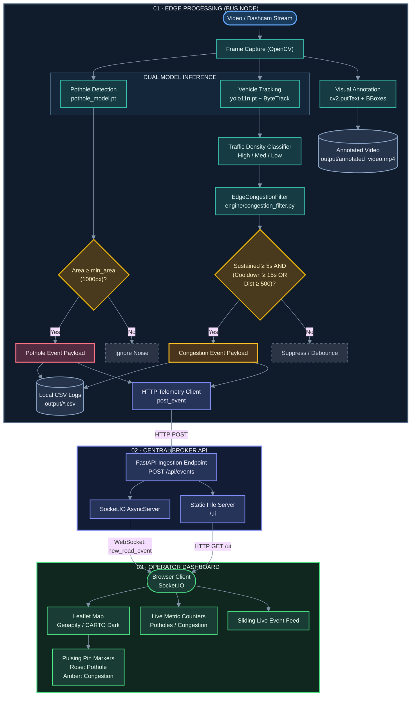

# Multi-Bus Urban Road Intelligence System

An edge-to-cloud transportation intelligence platform that turns fleet buses into real-time road condition sensors. The system detects road surface hazards (potholes) and analyzes traffic congestion locally on edge devices, transmitting telemetry to a centralized real-time map dashboard.

---

## Architecture Flowchart


---

## Important Modules

| Module | Location | Purpose |
|---|---|---|
| **Edge Inference Pipeline** | [`inference.py`](file:///D:/PotholeProject/inference.py) | Main video processing loop. Runs YOLO pothole inference, YOLO ByteTrack vehicle tracking, synthetic GPS drift modeling, and telemetry dispatch. |
| **Edge Congestion Filter** | [`engine/congestion_filter.py`](file:///D:/PotholeProject/engine/congestion_filter.py) | Temporal debouncer that prevents alert spam. Confirms congestion only if traffic remains high for 5 seconds, subject to a 15-second cooldown or 500-unit displacement trigger. |
| **Event Broker API** | [`backend/server.py`](file:///D:/PotholeProject/backend/server.py) | FastAPI application paired with an ASGI Socket.IO server. Validates telemetry payloads via Pydantic (`RoadEvent`), broadcasts events via WebSockets, and hosts the frontend UI under `/ui`. |
| **Operator Dashboard** | [`frontend/index.html`](file:///D:/PotholeProject/frontend/index.html) | Single-page monitoring interface styled with Tailwind CSS and Leaflet.js. Features live counters, dark-mode mapping with fallback tiles, and animated detection cards. |
| **Dataset Deduplication & Merger** | [`merge_datasets.py`](file:///D:/PotholeProject/merge_datasets.py) | Merges heterogeneous pothole datasets, runs SHA-256 content deduplication, normalizes bounding box annotations, partitions into 80/10/10 splits, and exports YOLO `data.yaml`. |
| **Dataset Sanity Checker** | [`check_dataset.py`](file:///D:/PotholeProject/check_dataset.py) | Samples random images from train/val/test splits and plots bounding box annotations via OpenCV and Matplotlib to verify label alignment. |

---

## Project Setup & Running

This project uses [`uv`](https://github.com/astral-sh/uv), an extremely fast Python package and project manager.

### 1. Prerequisites

- Python 3.10+ installed
- `uv` installed. If you do not have it, install via:
  ```powershell
  # Windows PowerShell
  powershell -ExecutionPolicy ByPass -c "irm https://astral.sh/uv/install.ps1 | iex"
  ```
  *(or via `pip install uv`)*

### 2. Virtual Environment Setup with `uv`

Create and activate a virtual environment using `uv`:

```powershell
# Create virtual environment in .venv
uv venv .venv

# Activate environment (Windows)
.\.venv\Scripts\activate

# (Linux / macOS equivalent: source .venv/bin/activate)
```

### 3. Install Dependencies with `uv`

Install pinned dependencies directly into the environment:

```powershell
uv pip install -r requirements.txt
```

### 4. Configuration

Copy the example environment configuration:

```powershell
cp .env.example .env
```

*(Optional)* Open `.env` and add your [Geoapify API key](https://www.geoapify.com/) for high-resolution dark-matter map tiles. If omitted, the dashboard automatically falls back to CARTO basemaps.

---

## Running the System

### Step 1: Start Backend Server

Launch the event broker and UI server:

```powershell
uv run uvicorn backend.server:socket_app --host 0.0.0.0 --port 8000 --reload
```
*(Or run `.\run_backend.bat`)*

Access the operator dashboard in your browser:
👉 **`http://localhost:8000/ui`**

### Step 2: Run Edge Inference

In a separate terminal, trigger inference on the sample test video:

```powershell
uv run python inference.py --video test_video.mp4 --backend http://localhost:8000 --bus-id BUS-001
```
*(Or run `.\run_inference.bat`)*

**Controls & Outputs:**
- Press `q` in the OpenCV video window to stop inference.
- Annotated video is stored in `output/annotated_video.mp4`.
- Extracted telemetry logs are written to `output/pothole_events.csv` and `output/congestion_events.csv`.

---

## Running Unit Tests

Run the engine test suite verifying congestion filtering, state transitions, and distance overrides:

```powershell
uv run python -m unittest discover -s tests
```
